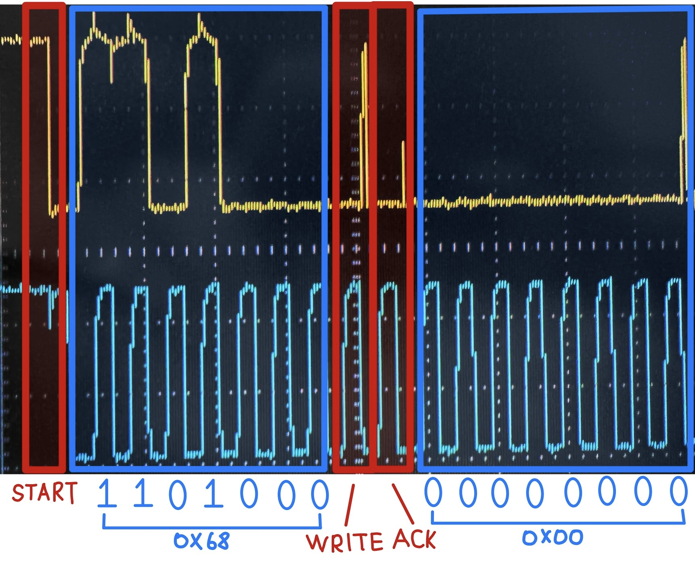
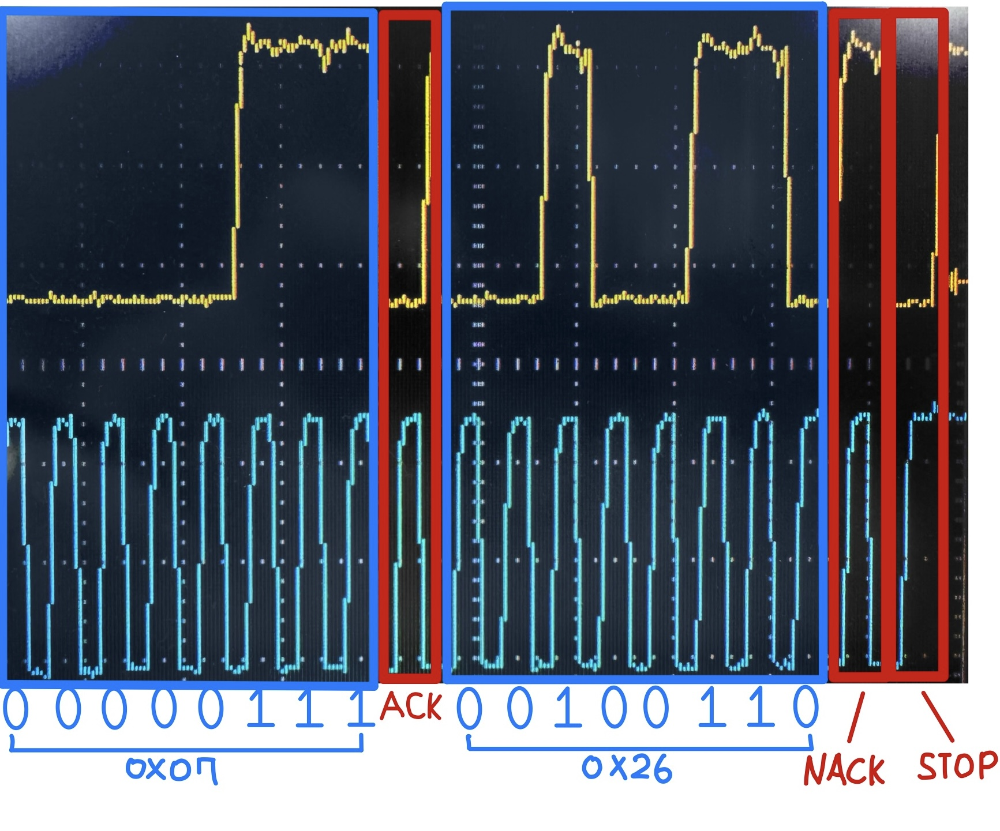
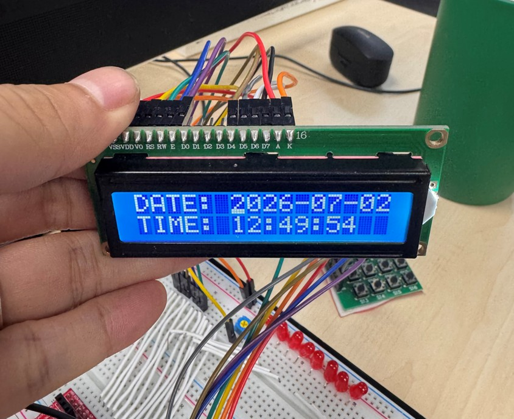

# ATmega128A RTC & Calculator

**I2C RTC 시계와 괄호·연산자 우선순위를 지원하는 정수 계산기를 하나의 AVR 펌웨어로 통합한 프로젝트입니다.**

ATmega128A의 레지스터를 직접 제어해 DS1307, LCD1602, 키패드, 버튼을 연결했습니다. Timer0의 시간 기준으로 기능을 통합하고, **오실로스코프로 SDA·SCL을 동시 관측해 I2C 주소·데이터·ACK/NACK을 파형에서 해석**했습니다.

`C` · `ATmega128A` · `AVR-GCC` · `I2C / TWI` · `Oscilloscope` · `Timer Interrupt` · `LCD 4-bit` · `Recursive Descent Parser`

[I2C 계측·분석](#오실로스코프를-이용한-i2c-분석) · [전체 동작 영상](https://github.com/user-attachments/assets/92abe7bb-5f36-4730-b449-3d3581099c04) · [설계 상세](docs/design.md) · [하드웨어·빌드·검증](docs/hardware-and-build.md)

## 프로젝트 한눈에 보기

| 항목      | 내용                                                                              |
| --------- | --------------------------------------------------------------------------------- |
| 주요 기능 | 날짜·시각 표시 및 수정, 정수 사칙연산, 중첩 괄호, 계산기 미사용 시 시계 자동 복귀 |
| 하드웨어  | ATmega128A · DS1307 RTC · LCD1602 · 4×4 키패드 · 버튼 5개                         |
| 실행 구조 | RTOS 없이 메인 루프와 Timer0 인터럽트 사용, 16 MHz 클록 전제                      |
| 구현 범위 | TWI 통신, BCD 변환, LCD 4비트 드라이버, 입력 처리, 모드 전환, 수식 파서           |
| 확인 자료 | 실물 사진, 기능별 시연 영상 4개, 주석이 포함된 I2C 파형 캡처 5개                  |

## 오실로스코프를 이용한 I2C 분석

**SDA·SCL의 실제 파형을 비트 단위로 읽고, RTC 드라이버의 주소 지정·데이터 수신·종료 순서와 대조했습니다.** 아래는 기존 계측 기록 중 통신의 시작과 끝을 보여주는 대표 구간입니다. 노란색은 SDA, 파란색은 SCL이며 테두리와 손글씨는 분석 주석입니다. 이미지를 클릭하면 원본을 볼 수 있습니다.

| ① START·장치 주소·레지스터 지정                                                                                                                        | ② 월·년 수신과 NACK·STOP                                                                                                     |
| ------------------------------------------------------------------------------------------------------------------------------------------------------ | ---------------------------------------------------------------------------------------------------------------------------- |
|  |  |

| 항목     | 파형에서 읽은 내용                                                 | 코드와의 대응                                                                    |
| -------- | ------------------------------------------------------------------ | -------------------------------------------------------------------------------- |
| **주소** | 7비트 주소 `0x68` + Write 비트 `0`, 이어지는 ACK와 레지스터 `0x00` | 전송 바이트 `0xD0`으로 RTC에 접근하고 초 레지스터부터 읽도록 포인터 지정         |
| **BCD**  | 월 `0x07`, 년 `0x26`의 BCD 데이터                                  | 월은 `bcd_to_decimal()`로 7, 년은 변환값에 2000을 더해 2026으로 구성             |
| **종료** | 마지막 년 데이터 뒤 NACK, 이어지는 STOP                            | 중간 바이트는 `I2C_receive_ACK()`, 마지막은 `I2C_receive_NACK()` 후 `I2C_stop()` |

관련 구현: [ds1307_get_time()](ds1307.c) · [TWI 송수신 드라이버](I2C_RTC.c)

이 자료의 확인 범위는 주소·데이터·응답 순서입니다. 현재 소스와 계측 당시 펌웨어의 버전 대응, SCL 주기·상승시간은 재확인이 필요합니다. [전체 파형과 현재 I2C 설정의 제약](docs/hardware-and-build.md#i2c-파형-자료)은 상세 문서에 정리했습니다.

## 핵심 구현

| 구현       | 설계 내용                                                                                                       | 관련 코드                                                                        |
| ---------- | --------------------------------------------------------------------------------------------------------------- | -------------------------------------------------------------------------------- |
| **RTC**    | TWI 레지스터로 START·전송·ACK/NACK·STOP 제어, 시간 레지스터 7바이트 읽기, BCD 변환 및 CH 비트 처리              | [I2C_RTC.c](I2C_RTC.c), [ds1307.c](ds1307.c)                                     |
| **Timer**  | 약 1 ms tick을 기준으로 키패드 60 ms, RTC 읽기 200 ms 주기 처리. 계산기에서 10초 동안 입력이 없으면 시계로 복귀 | [main.c](main.c), [timer0.c](timer0.c)                                           |
| **Parser** | 재귀 하향 파서로 괄호 → 곱셈·나눗셈 → 덧셈·뺄셈 순서 적용. `int64_t` 연산과 자체 문자열 변환 사용               | [cal.c](cal.c)                                                                   |
| **UI**     | 모드에 따라 버튼 기능을 전환하고, 변경 시 LCD 갱신 요청. 긴 수식은 마지막 16자를 표시                           | [ui.c](ui.c), [lcd1602.c](lcd1602.c), [keypad.c](keypad.c), [button.c](button.c) |

타이머 기반의 협력형 메인 루프이며, 버튼 디바운싱·LCD 출력·TWI 통신 내부에는 동기 대기가 있습니다. 실행 흐름과 상태 전환은 [설계 문서](docs/design.md)에 정리했습니다.

## 동작 시연

  

<table>
  <tr>
    <td width="50%" valign="top">
      <a href="https://github.com/user-attachments/assets/92abe7bb-5f36-4730-b449-3d3581099c04"><strong>① 전체 동작</strong></a>  
      시계→계산기 모드 전환과 괄호 오류의 <code>=ERROR</code> 표시
    </td>
    <td width="50%" valign="top">
      <a href="https://github.com/user-attachments/assets/d595cd02-ee3e-44b4-81f3-7f916f3c6f78"><strong>② 계산기 초기화</strong></a>  
      입력한 수식과 결과를 지우고 입력 화면을 <code>0</code>으로 초기화
    </td>
  </tr>
  <tr>
    <td width="50%" valign="top">
      <a href="https://github.com/user-attachments/assets/470df7b3-cfb5-4ec2-ac9d-55d87324b0be"><strong>③ 계산기 대기</strong></a>  
      계산기 입력 후 대기하면 시계 화면으로 자동 복귀
    </td>
    <td width="50%" valign="top">
      <a href="https://github.com/user-attachments/assets/c77f9c1f-f205-4c64-978e-72557a939b2a"><strong>④ 긴 수식 입력</strong></a>  
      16자를 넘는 수식의 표시 영역 이동과 계산 결과 출력
    </td>
  </tr>
</table>

각 제목을 클릭하면 GitHub 첨부 영상을 볼 수 있습니다. 원본 MP4 파일은 `docs/assets/videos/`에 보관했습니다.

## 사용 방법

1. 전원을 켜면 날짜와 시각을 표시합니다. **BTN4**로 시계와 계산기를 전환합니다.
2. 시계에서 **BTN3**을 누르면 수정 모드로 진입합니다. **BTN2**로 연→월→일→시→분→초를 선택하고, **BTN0 / BTN1**로 값을 감소·증가시킵니다. **BTN3**으로 RTC에 저장합니다.
3. 계산기에서 키패드로 숫자와 `+ - * / =`를 입력합니다. **BTN2 / BTN3**은 `(` / `)`, **BTN0**은 전체 지우기, **BTN1**은 한 글자 지우기입니다.

예: `2+3*4=` → `14`, `(2+3)*4=` → `20`. 정수 나눗셈이므로 `7/2=` → `3`입니다. 버튼 입력은 누른 뒤 **놓을 때** 처리됩니다.

## 빌드 및 검증

Windows의 Microchip Studio / Atmel Studio 7에서 [16.I2C_RTC_CALC.cproj](16.I2C_RTC_CALC.cproj)를 열고, 대상 MCU `ATmega128A`와 `ATmega_DFP 1.7.374`를 확인한 뒤 빌드합니다. 실제 보드의 클록도 소스의 `F_CPU=16000000UL`과 일치해야 합니다.

2026-10-23에 AVR-GCC 5.4.0으로 현재 소스 9개를 Debug 설정에 맞춰 직접 컴파일·링크하고 HEX 생성을 확인했습니다. `-Wall` 경고는 없었으며, 프로그램 영역은 **7,522 B**, 정적 데이터 영역은 **264 B**였습니다. 정적 데이터 수치에는 실행 중 스택 사용량이 포함되지 않습니다.

현재 I2C 속도 설정과 DS1307 규격의 차이, 입력 유효성·정수 오버플로 검사 등 남은 제약은 [검증 범위와 개선 항목](docs/hardware-and-build.md#검증-범위와-개선-항목)에 명시했습니다. 기존 실물 자료와 이번 빌드 확인은 구분하며, 이번 문서 정리에서 보드 재시험은 수행하지 않았습니다.

## 상세 문서

- [소프트웨어 설계](docs/design.md): 실행 흐름, 모드 전환, 버튼 매핑, RTC 트랜잭션, 수식 파서
- [하드웨어·빌드·검증](docs/hardware-and-build.md): 핀맵, 회로도 주의점, 개발 환경, 파형 자료, 재시험 항목

사진·영상·파형은 `docs/assets/`에 모았습니다. 빌드 출력과 개인별 IDE 파일은 Git 추적에서 제외하며, 소스와 `.cproj`로 다시 생성합니다.
