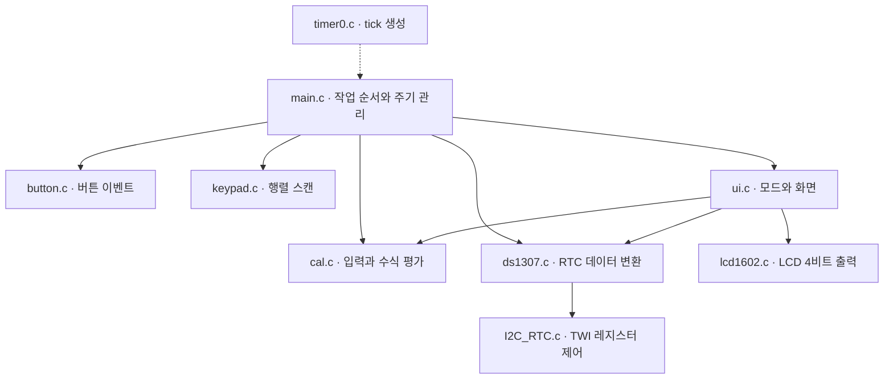
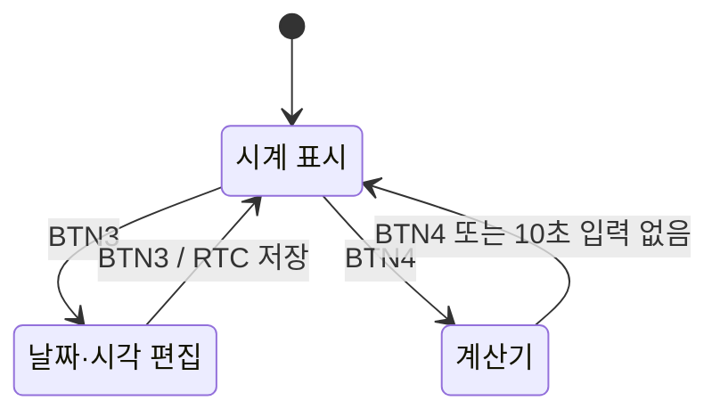

# 소프트웨어 설계

[프로젝트 소개](../README.md) · [하드웨어·빌드·검증](hardware-and-build.md)

현재 소스 기준으로 모듈의 역할과 동작을 설명합니다. 아래 Mermaid 도식은 코드에서 재구성한 설명 자료이며, 실측 결과와는 구분합니다.

## 모듈 구성



| 파일                                             | 책임                                               |
| ------------------------------------------------ | -------------------------------------------------- |
| [main.c](../main.c)                              | 초기화, 버튼·RTC·키패드·타임아웃·렌더링 작업 실행  |
| [timer0.c](../timer0.c)                          | Timer0 overflow ISR에서 `ms_count` 증가            |
| [ui.c](../ui.c), [ui.h](../ui.h)                 | 화면 모드, 시간 편집, 버튼 핸들러, LCD 문자열 출력 |
| [rtc.h](../rtc.h)                                | 날짜·시각 구조체와 편집 필드 정의                  |
| [ds1307.c](../ds1307.c)                          | BCD 변환, RTC 초기화·읽기·쓰기                     |
| [I2C_RTC.c](../I2C_RTC.c)                        | START, 바이트 송수신, ACK/NACK, STOP               |
| [cal.c](../cal.c)                                | 수식 버퍼, 파싱, 결과와 표시 문자열 생성           |
| [button.c](../button.c), [keypad.c](../keypad.c) | GPIO 입력과 놓음 이벤트 검출                       |
| [lcd1602.c](../lcd1602.c)                        | LCD 초기화, 명령·데이터의 상·하위 니블 전송        |

`ui.c`가 표시 문자열과 모드별 조작을 담당하고 `cal.c`가 계산 상태와 파서를 담당합니다. 상태는 전역 변수로 공유하며, 모든 드라이버 호출을 하나의 추상 계층으로 감싼 구조는 아닙니다.

## 실행 흐름과 시간 기준

초기화 순서는 Timer0 → 버튼 → 키패드 → 계산기 → DS1307 → LCD입니다. 초기화가 끝나면 `sei()`로 인터럽트를 허용하고 다음 작업을 순서대로 반복합니다.

| 순서 | 함수                     | 실행 조건                                                        |
| ---- | ------------------------ | ---------------------------------------------------------------- |
| 1    | `task_process_buttons()` | 매 루프, 버튼 5개 확인. 이벤트 1개를 처리하면 다음 작업으로 진행 |
| 2    | `task_sync_rtc()`        | 시간 편집 중이 아닐 때 200 ms 간격으로 RTC 읽기                  |
| 3    | `task_process_keypad()`  | 계산기 모드에서 60 ms 간격으로 스캔                              |
| 4    | `task_check_timeout()`   | 계산기에서 마지막 입력 이후 10,000 ms 경과 시 시계 복귀          |
| 5    | `task_render_display()`  | `should_render_display`가 설정되면 화면 갱신                     |

Timer0은 16 MHz, 64분주, `TCNT0=6`을 사용합니다. 명목상 overflow 간격은 `(256−6) × 64 / 16,000,000 = 1 ms`입니다. ISR은 카운터를 재설정하고 `ms_count`를 증가시키며, RTC 접근이나 LCD 출력은 메인 문맥에서 수행합니다. ISR 진입·재설정 지연이 있어 정확한 1 ms 계측 결과로 해석하지 않습니다.

RTC는 주기마다 읽되 초 값이 달라질 때 날짜·시각 구조체를 교체합니다. 시계 모드에서는 이때 화면 갱신을 요청하고, 계산기 모드에서는 계산 화면을 유지합니다. 편집 중에는 주기적 RTC 읽기를 중단해 편집값이 덮어써지지 않도록 합니다.

이 구조는 **협력형 메인 루프**입니다. 버튼에는 전이당 15 ms 대기, LCD에는 명령·데이터 전송 지연, TWI에는 `TWINT` 폴링 대기가 있어 작업 주기는 실행 지연의 영향을 받습니다. `volatile uint32_t ms_count`를 8비트 MCU에서 읽을 때의 원자성도 현재 보장하지 않습니다.

## 모드 전환과 입력



편집 상태에서는 BTN4 전환을 차단합니다. 편집 모드는 `MODE_CLOCK`과 `is_edit_mode`의 조합입니다. 계산기에서 시계로 나갔다가 다시 들어와도 수식은 유지되며, BTN0으로 지웁니다.

| 버튼 | MCU 핀 | 시계 표시     | 시간 편집              | 계산기         |
| ---- | ------ | ------------- | ---------------------- | -------------- |
| BTN0 | PD3    | 변경 없음     | 선택값 감소            | 전체 지우기    |
| BTN1 | PD4    | 변경 없음     | 선택값 증가            | 한 글자 지우기 |
| BTN2 | PD5    | 변경 없음     | 연→월→일→시→분→초 순환 | `(` 입력       |
| BTN3 | PD6    | 편집 진입     | RTC 저장 후 편집 종료  | `)` 입력       |
| BTN4 | PD7    | 계산기로 전환 | 전환 차단              | 시계로 전환    |

버튼은 Active High이며 놓음 이벤트에서 처리합니다. 키패드는 열을 LOW로 구동하고 풀업된 행 입력을 읽으며, 눌림을 기록한 뒤 놓였을 때 문자를 반환합니다. 키패드의 빈 칸 키는 계산 수식에 추가하지 않습니다.

## DS1307 읽기와 초기화

7비트 장치 주소는 `0x68`입니다. 버스에 전송하는 주소 바이트는 쓰기 `0xD0`, 읽기 `0xD1`입니다. [ds1307_get_time()](../ds1307.c)은 다음 순서로 동작합니다.

```text
START → 0xD0 → 0x00 → STOP
START → 0xD1 → 초 → 분 → 시 → 요일 → 일 → 월 → 년 → STOP
               ACK  ACK  ACK   ACK   ACK  ACK  NACK
```

위 ACK/NACK 표기는 데이터 수신 후 마스터가 보내는 응답입니다. 코드에서는 레지스터 포인터 지정 뒤 STOP을 내고 다시 START합니다.

수신 데이터는 BCD에서 10진수로 변환합니다. 초의 CH 비트를 마스킹하고, 연도의 하위 두 자리에 2000을 더합니다. 쓰기에서는 24시간 형식과 `CH=0`을 설정합니다.

부팅 시 초 레지스터의 CH가 1이면 초기값 `2026-07-01 12:00:00`을 쓰고, CH가 0이면 기존 RTC 값을 읽습니다. **CH는 오실레이터 정지 여부를 나타내며 배터리 상태나 날짜 유효성을 증명하지 않습니다.** 외부에서 12시간 모드로 설정한 RTC의 변환 처리는 구현하지 않았습니다. 레지스터 의미는 [DS1307 데이터시트의 Timekeeper Registers](https://www.analog.com/media/en/technical-documentation/data-sheets/DS1307.pdf)를 기준으로 합니다.

## 수식 파서와 LCD 표시

의도한 수식 문법과 파서 대응은 다음과 같습니다.

```text
식      := 항 { ('+' | '-') 항 }        parse_add_sub()
항      := 기본식 { ('*' | '/') 기본식 }  parse_mul_div()
기본식  := 숫자열 | '(' 식 ')'           parse_bracket()
```

괄호 안에서는 `parse_add_sub()`를 재귀 호출합니다. 같은 우선순위의 연산은 왼쪽부터 처리하며, 나눗셈은 정수 나눗셈입니다. `int64_t`로 계산하고 `int_to_str()`로 출력 문자열을 만듭니다. 부동소수점, 명시적인 단항 연산자 문법, 결과를 이어 쓰는 연산은 구현하지 않았습니다.

| 항목              | 현재 동작                                                       |
| ----------------- | --------------------------------------------------------------- |
| 수식 저장         | `expr[50]`, 종료 문자 제외 최대 49자. 이후 입력은 추가하지 않음 |
| 첫째 줄           | 수식이 16자를 넘으면 마지막 16자를 표시                         |
| 둘째 줄           | `=결과` 또는 `=ERROR`. 결과가 길면 마지막 16자만 표시           |
| 계산 후 입력      | 숫자·사칙연산자·괄호 입력 시 이전 계산을 초기화                 |
| 계산 후 Backspace | 이전 수식 전체 초기화                                           |
| 오류 처리         | 괄호 짝 오류를 검사하지만 전체 문법 검증은 불완전               |

표시 영역 이동은 문자열 시작 포인터를 바꾸는 **소프트웨어 처리**입니다. LCD는 4비트 인터페이스로 초기화하고 한 바이트를 상위·하위 니블로 나누어 전송합니다. 화면 지우기는 별도로 2 ms를 기다립니다.

`int64_t` 사용 자체가 오버플로 방지를 보장하지는 않습니다. 0 나눗셈, 잘못된 수식, 정수 범위, 표시 잘림 등 구체적인 제약과 확인 사례는 [검증 문서](hardware-and-build.md#검증-범위와-개선-항목)를 참고하세요.
