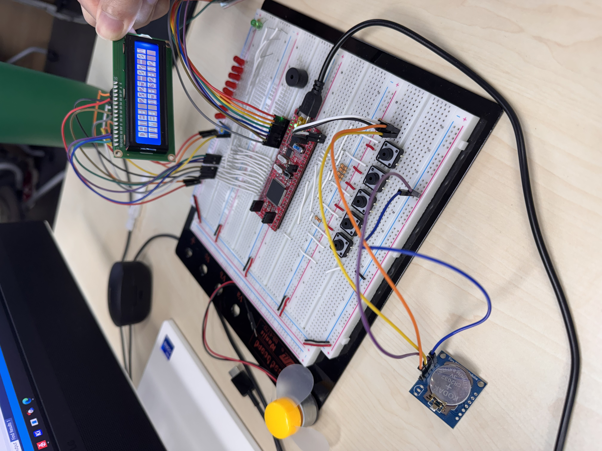
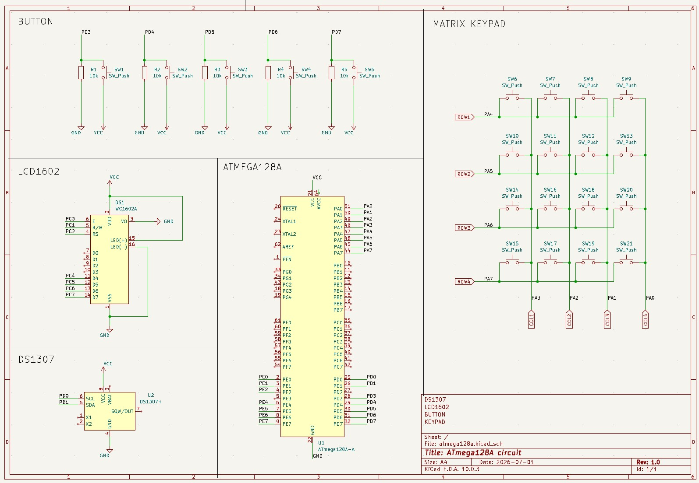

# 하드웨어·빌드·검증

[프로젝트 소개](../README.md) · [소프트웨어 설계](design.md)

## 하드웨어 구성과 핀맵

| 구성            | 역할                              |
| --------------- | --------------------------------- |
| ATmega128A      | 16 MHz 클록을 전제로 한 MCU 제어  |
| DS1307 RTC      | I2C로 날짜·시각 읽기 및 저장      |
| LCD1602         | 16자 × 2줄 표시, 4비트 병렬 연결  |
| 4×4 키패드      | 숫자·사칙연산자·등호 입력         |
| Push Button 5개 | 화면 전환, 시간 편집, 계산기 편집 |

<details>
<summary>실물 구성 사진</summary>



</details>

**아래 핀맵은 현재 소스가 기준입니다.**

| 신호                             | ATmega128A 핀               | 소스 기준                       |
| -------------------------------- | --------------------------- | ------------------------------- |
| RTC SCL                          | PD0                         | `I2C_SCL`                       |
| RTC SDA                          | PD1                         | `I2C_SDA`                       |
| BTN0 / BTN1 / BTN2 / BTN3 / BTN4 | PD3 / PD4 / PD5 / PD6 / PD7 | `BUTTON_0_PIN` ~ `BUTTON_4_PIN` |
| LCD RS / R/W / E                 | PC0 / PC1 / PC2             | `LCD_RS` / `LCD_RW` / `LCD_E`   |
| LCD D4 / D5 / D6 / D7            | PC4 / PC5 / PC6 / PC7       | `lcd_send_nibble()`             |
| 키패드 행 R1 / R2 / R3 / R4      | PA4 / PA5 / PA6 / PA7       | 상위 4비트 입력, 내부 풀업      |
| 키패드 열 C1 / C2 / C3 / C4      | PA3 / PA2 / PA1 / PA0       | 하위 4비트 출력, 선택 열 LOW    |

버튼 입력은 Active High이며 소스에서 내부 풀업을 활성화하지 않습니다. 외부 풀다운이 있는 회로를 전제로 합니다. 키패드 문자 배열은 일반적인 제품 인쇄 배열과 다를 수 있으므로 실제 배선과 함께 확인해야 합니다.

| 소스의 행 순서 | C1 (PA3) | C2 (PA2) | C3 (PA1) | C4 (PA0) |
| -------------- | -------- | -------- | -------- | -------- |
| R1 (PA4)       | 공백     | `0`      | `=`      | `+`      |
| R2 (PA5)       | `4`      | `5`      | `6`      | `*`      |
| R3 (PA6)       | `7`      | `8`      | `9`      | `-`      |
| R4 (PA7)       | `1`      | `2`      | `3`      | `/`      |

<details>
<summary>기존 회로도 이미지와 차이점</summary>



이 이미지는 기존 저장소의 배선 참고 자료입니다. LCD 제어선이 `E=PC3`, `RS=PC2`로 표시되어 있어 현재 소스의 `E=PC2`, `RS=PC0`과 다릅니다. 또한 키패드 R3 표기에 PA5가 중복되어 있지만 소스에서는 PA6을 사용합니다.

MCU 외부 클록, RTC 크리스털·백업 전원, I2C 풀업 등 실제 구동에 필요한 연결을 모두 표현하지는 않습니다. KiCad 원본도 저장소에 없으므로 그대로 제작 가능한 완성 회로도로 해석하지 않습니다. 재배선할 때는 위 핀맵과 실제 보드를 대조해야 합니다.

</details>

## 개발 환경과 빌드

| 항목              | 저장소 설정 / 이번 확인 환경                                   |
| ----------------- | -------------------------------------------------------------- |
| 프로젝트          | `16.I2C_RTC_CALC.cproj`, Atmel/Microchip Studio 7 형식         |
| IDE               | 설치된 Atmel Studio 실행 파일 ProductVersion `7.0.0.4033` 확인 |
| 컴파일러          | AVR-GCC `5.4.0`, AVR 8-bit GNU Toolchain `3.6.2_1778`          |
| MCU / Device Pack | `ATmega128A` / `ATmega_DFP 1.7.374`                            |
| 언어 / 클록       | C, 생성 Makefile 기준 `-std=gnu99` / `F_CPU=16000000UL`        |
| 최적화            | Debug `-Og`, Release `-Os`                                     |

1. Windows에 Microchip Studio / Atmel Studio 7과 AVR 8-bit GNU Toolchain을 준비합니다.
2. `.cproj`를 열고 MCU와 Device Pack을 확인합니다. 프로젝트는 `ATmega_DFP 1.7.374`를 참조하므로 설치 경로와 Pack 해석이 맞아야 합니다.
3. `Debug` 또는 `Release` 구성을 선택하고 **Build → Build Solution**으로 빌드합니다.
4. 생성된 `.elf` 또는 `.hex`를 사용하는 프로그래머의 절차에 맞춰 기록합니다. 보드 모델·프로그래머·인터페이스·Fuse 값은 저장소에서 확정할 수 없으므로 임의의 업로드 명령을 제시하지 않습니다.

소스의 `F_CPU` 정의가 물리적 클록이나 Fuse를 설정하지는 않습니다. 실제 클록이 다르면 `_delay_*()`, Timer0 주기, TWI 속도가 함께 달라집니다.

`Debug/`의 Makefile과 바이너리는 IDE에서 다시 생성하는 파일입니다. 절대 경로를 포함하므로 저장소에서는 제외합니다. `.componentinfo.xml`도 로컬 Device Pack의 절대 경로를 담은 자동 생성 메타데이터로 제외하며, 공유 프로젝트 파일인 `.cproj`는 유지합니다.

### 이번 빌드 확인 결과

2026-10-23, Windows에서 위 AVR-GCC와 Device Pack으로 소스 9개를 임시 디렉터리에 직접 컴파일·링크했습니다. 생성 Makefile의 Debug 옵션에 맞춰 `-Og`, `-Wall`, `-funsigned-char`, `-funsigned-bitfields`, `-fpack-struct`, `-fshort-enums`, section GC, `-mrelax`, `libm`을 적용했습니다.

| 확인                                         | 결과                       |
| -------------------------------------------- | -------------------------- |
| 소스 컴파일·링크                             | 성공, `-Wall` 경고 없음    |
| ELF → Intel HEX 생성                         | 성공                       |
| `avr-size -C --mcu=atmega128a` 프로그램 영역 | 7,522 B / 131,072 B (5.7%) |
| 정적 데이터 영역                             | 264 B / 4,096 B (6.4%)     |

이는 IDE GUI의 Build 실행이나 Release 구성 검증을 대신한 결과는 아닙니다. 정적 데이터 영역은 `.data + .bss + .noinit`이며, 재귀 파서와 함수 호출의 런타임 스택 최대 사용량은 측정하지 않았습니다.

## I2C 파형 자료

기존 저장소에 포함된 오실로스코프 캡처입니다. 데이터시트와 대조할 수 있도록 주소 지정부터 수신 종료까지 순서대로 배치했습니다. 사진에 추가된 색 테두리와 손글씨는 해설 주석이며, 자동 디코더의 출력이 아닙니다.

| 캡처                                                   | 확인할 구간                                            |
| ------------------------------------------------------ | ------------------------------------------------------ |
| [1. 레지스터 포인터 지정](assets/images/i2c_wave1.png) | START, 7비트 주소 `0x68` + Write 비트, 레지스터 `0x00` |
| [2. 읽기 시작](assets/images/i2c_wave2.png)            | STOP 이후 START, `0x68` + Read 비트, 초 데이터         |
| [3. 연속 수신](assets/images/i2c_wave3.png)            | 분·시 데이터와 ACK                                     |
| [4. 연속 수신](assets/images/i2c_wave4.png)            | 요일·일 데이터와 ACK                                   |
| [5. 수신 종료](assets/images/i2c_wave5.png)            | 월·년 데이터, 마지막 바이트 뒤 NACK와 STOP             |


주소 주석의 `0x68`은 7비트 주소이며 전송 바이트 전체는 Write `0xD0`, Read `0xD1`입니다. 파일 3·4는 각각 분/시와 요일/일이고, 월/년과 종료 구간은 파일 5입니다.

캡처 2의 초 데이터에는 손글씨 비트열과 `0x54` 표기가 일치하지 않는 부분이 있습니다. 원본 계측 데이터와 해당 펌웨어 커밋이 함께 보관되어 있지 않으므로, 이 자료를 특정 바이트 값이나 현재 HEAD의 동작을 확정하는 증거로 사용하지 않습니다. [LCD 사진](assets/images/rtc_result.png)은 `2026-07-02 12:49:54` 표시를 보여주는 별도의 기록입니다.

### I2C 속도 설정과 규격

현재 [I2C_init()](../I2C_RTC.c)은 `TWBR=32`를 설정하며 `TWSR`의 prescaler 비트는 따로 쓰지 않습니다. 리셋 기본값인 prescaler 1과 16 MHz를 전제로 계산하면 다음과 같습니다.

```text
SCL = F_CPU / (16 + 2 × TWBR × prescaler)
    = 16,000,000 / (16 + 2 × 32 × 1)
    = 200,000 Hz
```

이는 설정값으로부터 계산한 값이며 실제 SCL 측정값은 아닙니다. [ATmega128A 데이터시트의 Bit Rate Generator Unit](https://ww1.microchip.com/downloads/en/DeviceDoc/Atmel-8151-8-bit-AVR-ATmega128A_Datasheet.pdf) 공식에 따른 계산입니다. **DS1307의 SCL 최대 규격은 100 kHz이므로 현재 설정은 규격과 맞지 않습니다.** 근거는 [DS1307 데이터시트의 AC Electrical Characteristics, p.3](https://www.analog.com/media/en/technical-documentation/data-sheets/DS1307.pdf)입니다.

16 MHz·prescaler 1에서 100 kHz에 해당하는 계산값은 `TWBR=72`입니다. 이번 작업에서는 펌웨어를 변경하지 않았으며, 속도 수정 후 SCL 주기·상승시간·ACK를 실물에서 다시 확인해야 합니다.

## 검증 범위와 개선 항목

| 구분                 | 현재 확인 범위                                                                                     |
| -------------------- | -------------------------------------------------------------------------------------------------- |
| 코드 확인            | 주기 상수, 모드별 조작, 핀 매핑, RTC 트랜잭션, 파서와 표시 방식                                    |
| 빌드 확인            | 위 환경에서 Debug 옵션 직접 컴파일·링크 및 HEX 생성                                                |
| 기존 실물 자료       | 이미지 내용, 영상 4개의 길이·코덱과 시작·중간·끝 프레임 확인. 현재 소스와의 동일성 보장 없음       |
| 이번 작업에서 미수행 | 보드 재시험, 영상 전체 프레임·입력 타이밍 검증, I2C 재계측, 배터리 유지·장시간 동작·최대 스택 측정 |

현재 구현에서 추가 검증 또는 보완이 필요한 항목입니다.

| 항목               | 현재 동작과 보완 방향                                                                                                      |
| ------------------ | -------------------------------------------------------------------------------------------------------------------------- |
| I2C 규격·오류 복구 | 계산상 200 kHz 설정. TWI 상태 코드 검사, NACK 처리, 폴링 타임아웃과 버스 복구가 없어 통신 이상 시 메인 루프가 멈출 수 있음 |
| 공유 tick 원자성   | ISR이 갱신하는 32비트 `ms_count`를 메인에서 원자적 스냅샷 없이 읽음. 8비트 MCU의 다중 바이트 읽기 보호 필요                |
| 수식 유효성        | 전체 토큰 소비와 피연산자 존재 검사가 없음. `2+`가 `2`, `2(3+4)`가 `2`로 계산되는 등 잘못된 수식을 허용할 수 있음          |
| 0으로 나누기       | 현재 `1/0`은 `0`으로 계산. 오류 상태로 보고하도록 보완 필요                                                                |
| 정수 범위          | 숫자 누적·사칙연산에 `int64_t` 오버플로 검사가 없음. `INT64_MIN` 문자열 변환 시 부호 반전도 범위를 벗어남                  |
| 날짜 편집          | 일은 월과 무관하게 1~31 순환. 윤년·월별 일수 검증과 요일 재계산이 없어 유효하지 않은 날짜를 저장할 수 있음                 |
| 표시·실행 자원     | 긴 결과는 부호·상위 자릿수가 잘릴 수 있음. 재귀 깊이에 따른 스택 여유 및 입력 처리 지연은 미계측                           |

### 보드 재시험 시 확인할 사례

아래는 **재시험 절차와 기대 동작**이며, 이번 작업에서 모두 통과했다는 기록은 아닙니다.

| 조작 / 조건                     | 확인할 내용                                                    |
| ------------------------------- | -------------------------------------------------------------- |
| 전원 인가·Reset                 | 시계 표시 진입, CH 상태에 따른 초기값 쓰기 또는 RTC 읽기       |
| BTN3 → BTN2 → BTN0/1 → BTN3     | 편집 필드 선택, 값 변경, 저장 후 시계 표시                     |
| 편집 중 BTN4                    | 계산기로 전환되지 않음                                         |
| BTN4 → `2+3*4=` / `(2+3)*4=`    | 각각 `14` / `20` 표시                                          |
| `7/2=` / `(2+3=`                | 각각 `3` / `=ERROR` 표시                                       |
| 16자를 넘는 수식 입력·Backspace | 마지막 16자 표시와 지우기 후 표시 영역 갱신                    |
| 계산기 진입 후 입력 없이 대기   | 소스상 10초 기준으로 시계 복귀. 실제 경과시간 별도 측정        |
| RTC 분리 또는 SDA 고정          | 현재 폴링 정지 가능성 확인. 오류 복구 개선 후 복구 동작 재시험 |

## 자료 관리

실물 사진·주석 파형·영상은 `assets/images/`, `assets/videos/`에 보관합니다. 본 문서 기준 상대 경로이며 저장소 루트에서는 `docs/assets/`입니다. 기존 촬영 장비 설정, 원본 파형 파일, KiCad 원본, 자료별 펌웨어 버전은 포함되어 있지 않습니다.

영상 1·2는 H.264, 영상 3·4는 HEVC 형식입니다. 브라우저·운영체제의 코덱 지원에 따라 웹 재생이 달라질 수 있어 README에는 저장소의 MP4 파일 경로와 다운로드 안내를 사용합니다. 영상 1의 Reset은 계산기 입력 초기화이며, MCU 하드웨어 Reset 동작을 입증하는 영상으로 분류하지 않습니다.

기존 FSM·아키텍처·파서 PNG는 현재 코드와 다른 설명이 있어 공개 문서에서 제외하고, [설계 문서](design.md)의 코드 기준 도식으로 대체했습니다. 로컬 원본은 Git에서 제외한 `assets/legacy/`에 보존합니다.
